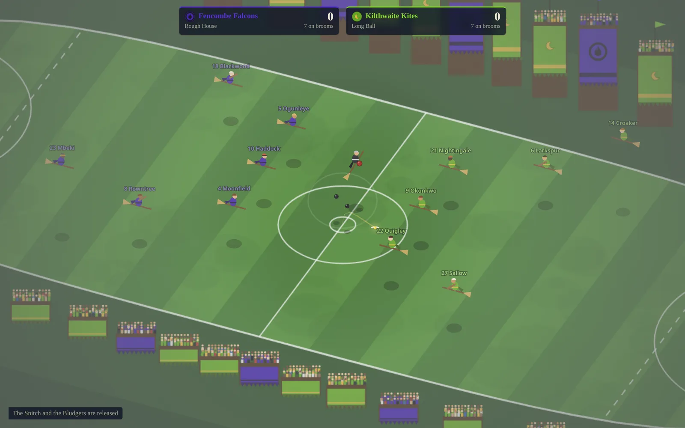
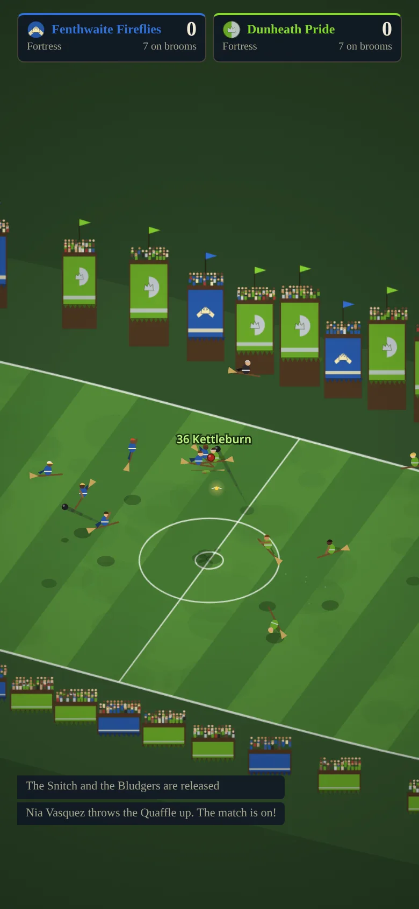

# Random Quidditch Matches

[](https://github.com/ali-raheem/random-quidditch-matches/actions/workflows/ci.yml) [](https://github.com/ali-raheem/random-quidditch-matches/actions/workflows/pages.yml)

**▶ Try it live: [shoryuken.me/rqm](https://shoryuken.me/rqm/)** · mirror on [GitHub Pages](https://ali-raheem.github.io/random-quidditch-matches/) · installable, works offline

<p align="center">
  <a href="https://shoryuken.me/rqm/"></a>
  <a href="https://shoryuken.me/rqm/"></a>
</p>

An endless, hands-off Quidditch broadcast. Each match pits two procedurally generated
clubs against each other under the full rules: Chasers, Keepers, Beaters and Seekers,
the Quaffle, two Bludgers and the Golden Snitch, fouls and penalties, time-outs and no
substitutions. When the Snitch is caught a full-time banner shows and a brand new match
starts.

No build step, no dependencies, no network calls. Plain HTML/CSS/JS modules plus a
service worker, so it installs as a PWA and runs fully offline. It is a sibling of
Random Space Battles and Random Medieval Battles and shares their architecture.

## Run it

```bash
python3 -m http.server 8080   # or: npm run serve
```

Open `http://localhost:8080/`. After the first load it works with the network off.
Use the browser's "Install app" / "Add to Home Screen" for a fullscreen app.

## Controls

| Key | Action |
|---|---|
| Space | Pause / resume |
| `+` / `-` | Simulation speed (0.5× – 4×) |
| `N` | Skip to a new match |
| `R` | Line-ups: every player, their role, key skills and match stats |
| `L` | Recent matches: the last 5 you watched, with result, replay and copy-link |
| `S` | Settings: install app, sound, player names, fullscreen, hide interface, version |
| `T` | Toggle player name labels |
| `H` | Hide the whole HUD (tap the screen to bring it back) |
| `M` | Sound on/off (remembered) |
| `F` | Fullscreen |
| `Esc` | Close the open panel |

Controls fade after a few idle seconds, and the tab holds a screen wake lock while
it's visible, so it works as a screensaver. On a touchscreen, the first tap brings
faded controls back without pressing anything.

Every match is fully determined by its seed, which is kept in the URL
(`#seed=0000002a`). Reloading replays the current match. Click the seed to copy a
link to it.

## The rules it plays

- **Sides**: seven a side. One Keeper, three Chasers, two Beaters, one Seeker.
- **Start**: the referee releases the Snitch and the Bludgers, then throws the Quaffle
  up from the centre circle.
- **Goals**: a Quaffle thrown through any of the three hoops is worth 10 points.
  Rebounds off the ring stay in play, and the conceding Keeper restarts.
- **The Snitch**: catching it is worth 150 points and ends the match. A Seeker more
  than 150 points behind usually won't catch it, because that would lose the match.
- **Bludgers** chase whoever is nearest. Beaters bat them at opponents, so a hit
  player drops the Quaffle and is dazed, and is occasionally knocked out.
- **No substitutions**: a knocked-out player stays out and their side plays short.
  A captain may call one time-out per match.
- **Out of bounds**: the Quaffle leaving the pitch goes to the other side.
- **Fouls** are called by a referee who doesn't see everything. Each one awards a
  penalty: one Chaser against the Keeper from the penalty spot. The fouls are
  Blagging, Blatching, Blurting, Bumphing, Cobbing, Flacking, Haversacking,
  Quaffle-pocking, Snitchnip and Stooging.
- **Mutual consent**: if both Seekers are out, or a match passes 15 minutes, the
  captains agree to end it.

The commentary calls the named moves when they happen: the Wronski Feint, Porskoff
Ploy, Parkin's Pincer, Woollongong Shimmy, Dopplebeater Defence, Bludger Backbeat,
Sloth Grip Roll, Reverse Pass, Double Eight Loop and Starfish and Stick.

## What gets randomised

- **Clubs**: town and nickname, kit colours, crest (division and glyph), captain,
  tactic (Hawkshead Attack, Possession Game, Long Ball, Bludger Barrage, Seeker
  Screen, Rough House, Fortress) and broom model.
- **Players**: names, shirt numbers and nine skills (speed, agility, catching,
  throwing, power, aim, keeping, vision, discipline), weighted towards their role.
- **The day**: the ground, the occasion, the referee, the crowd, time of day (day,
  evening, lantern-lit night) and weather (sun, overcast, wind that drifts the
  Quaffle, drizzle, rain, fog, snow).

## Structure

| File | Purpose |
|---|---|
| `js/rng.js` | Seeded PRNG (mulberry32) |
| `js/pitch.js` | Pitch geometry: boundary, hoops, scoring areas |
| `js/gen.js` | Club, line-up, broom, tactic and weather generation |
| `js/sim.js` | Deterministic, DOM-free simulation: flight, the balls, every role's AI, the rules |
| `js/crest.js` | Club crests, shared by the HUD (SVG) and the stand banners (canvas) |
| `js/render.js` | Canvas renderer: oblique stadium view, riders, balls, particles, light, weather |
| `js/audio.js` | Synthesised Web Audio: crowd, whistle, bat cracks, roars, fanfare |
| `js/recent.js` | Recent-matches list: summaries, de-duplication, `localStorage` persistence |
| `js/app.js` | Fixed-timestep loop, HUD, commentary feed, controls, panels, match rotation |
| `js/version.js` | Release version and build time, shown in Settings |
| `index.html` | Page shell, including the SVG icon sprite (`#i-*` symbols) |
| `sw.js`, `manifest.webmanifest` | Offline caching + install metadata |
| `tests/sim.test.mjs` | Generation validity, scores add up, fouls are legal, matches end, determinism |
| `tests/assets.test.mjs` | Every shipped file is cached; ids and storage prefixes are this app's own |

If you add a file, add it to `ASSETS` in `sw.js` too.

## Releasing

```bash
npm run bump            # patch; or: npm run bump -- minor | major
```

This updates `VERSION` and the `BUILT` timestamp in `js/version.js` (and
`package.json`). The service worker is registered as `sw.js?v=<VERSION>` and names
its cache after it, so installed copies pick up a clean cache on their next visit.

## Tests

```bash
npm test
```
